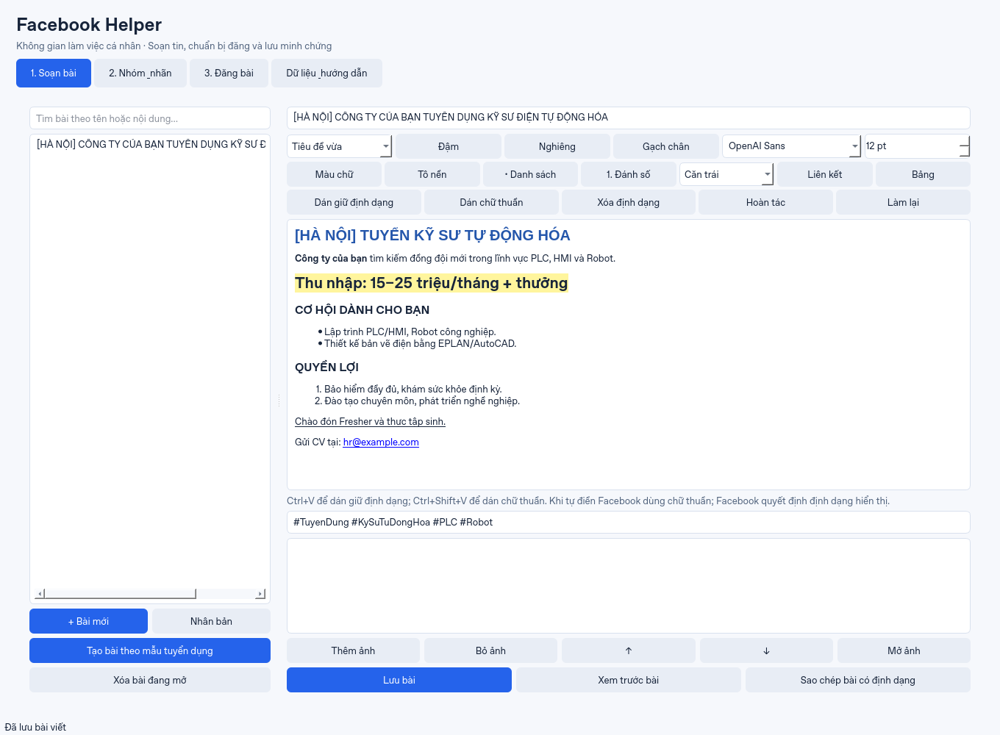

# Facebook Helper · HR

Ứng dụng desktop tiếng Việt cho một người dùng: soạn tin tuyển dụng theo mẫu, chọn nhóm bằng nhãn và thực hiện danh sách đăng lần lượt. **Python + PySide6 + Playwright + SQLite**.

## Tải về và mở ứng dụng

**[Tải bản Windows 10/11 64-bit](https://github.com/Trung27012003/facebook-helper/releases/latest/download/FacebookHelper-Windows-x64.zip)** · [Các bản phát hành](https://github.com/Trung27012003/facebook-helper/releases)

Giải nén **toàn bộ** ZIP → mở thư mục `FacebookHelper` → nhấp đúp `FacebookHelper.exe`. Không cần cài Python hay Chromium. Giữ nguyên `_internal` đi kèm, không chạy bên trong ZIP. Bản portable chưa ký mã số; thông tin kiểm tra và SHA256 nằm ở trang phát hành.

## Cách dùng bản 0.3

### 1. Soạn bài

- Chọn **Tạo bài theo mẫu tuyển dụng**. Điền vị trí, công ty, khu vực, thu nhập, công việc, yêu cầu, quyền lợi, địa điểm, thời gian và liên hệ. Mục không cần có thể để trống.
- Mẫu tạo tiêu đề, các phần **CƠ HỘI DÀNH CHO BẠN / YÊU CẦU / QUYỀN LỢI / ỨNG TUYỂN NGAY** và các dòng `•`, giống bố cục bài tuyển dụng tham khảo.
- **Dán bài có định dạng:** copy từ Word/trang web → nhấn **Ctrl+V** hoặc **Dán giữ định dạng**. Giữ các định dạng Qt hỗ trợ: đậm/nghiêng/gạch chân, font, cỡ chữ, màu, nền, tiêu đề, danh sách, căn lề, liên kết và bảng. Nguồn cần cung cấp HTML; clipboard chỉ có chữ thuần sẽ không khôi phục được kiểu chữ.
- Thanh soạn thảo có định dạng tiêu đề, danh sách `•`/đánh số, màu chữ/tô nền, căn lề, chèn link/bảng, xóa định dạng, hoàn tác/làm lại. **Ctrl+Shift+V** dán chữ thuần. **Sao chép bài có định dạng** sao chép cả HTML và chữ thuần kèm hashtag để nơi nhận chọn định dạng hỗ trợ.
- Ảnh nằm trong nội dung dán không tự được tải/import. Dùng **Thêm ảnh** để đính kèm; ứng dụng không tự đọc ảnh từ đường dẫn trong HTML.
- Sửa nội dung trực tiếp, chọn nhiều ảnh, sắp xếp thứ tự, thêm hashtag, **Xem trước bài** rồi **Lưu bài**. Tiêu đề quản lý không được tự chèn lần nữa vào nội dung.
- Font, cỡ chữ, màu và chữ đậm/nghiêng/gạch chân được lưu trong bản nháp. Khi điền Facebook dùng chữ thuần, giữ tiêu đề, xuống dòng, dấu đầu dòng, số thứ tự và chuyển bảng thành các hàng chữ đọc được. Facebook quyết định kiểu chữ/ảnh; không cam kết giữ nguyên định dạng Word. Ảnh thiết kế tuyển dụng do bạn tải lên, không tự tạo từ mẫu chữ.

### 2. Nhóm & nhãn

Thêm tên, link nhóm và ghi chú quy định. **Nhãn nhóm** dùng để chọn nơi đăng, không được chèn vào bài.

Ví dụ:

| Nhóm | Nhãn |
|---|---|
| Việc làm kỹ thuật Hà Nội | Hà Nội, Kỹ thuật |
| Cộng đồng tự động hóa | Hà Nội, Kỹ thuật |
| Việc làm kế toán | Hà Nội, Kế toán |

Một nhóm có thể có nhiều nhãn, ngăn cách bằng dấu phẩy. Nhiều nhóm dùng chung nhãn. Chọn nhãn **Kỹ thuật** sẽ chọn hai nhóm đầu; nhãn **Hà Nội** sẽ chọn cả ba. Nhãn khớp chính xác và không phân biệt hoa/thường, không tìm theo một phần tên. Có ô tìm nhóm theo tên/nhãn.

### 3. Đăng bài lần lượt

1. Bấm **Đăng nhập Facebook** ở đầu màn hình, đăng nhập trực tiếp trong trình duyệt riêng của ứng dụng. Phiên không dùng chung với Chrome cá nhân.
2. Chọn một bài đã lưu, rồi chọn **Một nhóm**, **Nhiều nhóm** hoặc **Theo nhãn nhóm**.
3. Kiểm tra danh sách đã tích; có thể bỏ bớt nhóm. Thứ tự thực hiện là từ trên xuống.
4. Đặt tên danh sách nếu muốn → **Tạo danh sách đăng**. Mỗi nhóm có một lượt riêng, giữ bản nội dung/ảnh tại thời điểm tạo. Có thể tạo nhiều danh sách cho nhiều bài khác nhau trước khi bắt đầu.
5. Chọn cách thực hiện rồi **Bắt đầu / tiếp tục**:
   - **Mặc định kiểm tra từng nhóm:** ứng dụng mở nhóm, cố gắng mở cửa sổ tạo bài và điền nội dung/ảnh. Bạn kiểm tra, tự bấm Đăng trên Facebook, rồi bấm **Đã gửi · sang nhóm sau** và chọn kết quả thực tế.
   - **Tự bấm Đăng lần lượt:** tích tùy chọn này, chọn thời gian giữa các nhóm rồi bắt đầu. Ứng dụng hỏi xác nhận bài và các nhóm trước khi tự điền/bấm Đăng. Gửi xong sẽ chờ trước khi chuyển nhóm.
6. **Tạm dừng** dừng việc chuyển nhóm tiếp theo; thao tác hiện tại vẫn hoàn tất. **Bỏ qua nhóm này** bỏ qua trong danh sách hiện tại. Tiếp tục sẽ bỏ qua các lượt đã gửi hoặc đã xử lý.
7. Nếu không nhận diện được ô soạn: danh sách dừng; tự mở **Viết gì đó / Tạo bài viết** trên Facebook, quay lại bấm **Điền bài (nếu cần)**. Có thể mở phần công cụ bổ sung để sao chép chữ và mở thư mục ảnh để đăng thủ công.
8. Nếu chưa rõ kết quả sau khi bấm Đăng, ứng dụng dừng và yêu cầu kiểm tra. Không tự gửi lại. Nếu lần trước đang gửi thì ứng dụng bị tắt, cũng phải kiểm tra trước khi tiếp tục.

**Đã gửi không đồng nghĩa đã được duyệt.** Ứng dụng không tự xác định bài đã hiển thị. Chỉ xác nhận đã hiển thị sau khi mở bài thật và có permalink.

### Link, ảnh minh chứng và báo cáo

Mở **Link bài, trạng thái & ảnh minh chứng** bên dưới bảng. Dán và lưu link bài, hoặc mở bài cụ thể trong trình duyệt của ứng dụng rồi **Lấy link đang mở**. Link cần thuộc cùng nhóm, dạng `/groups/ID/posts/ID/`; nếu Facebook dùng ID/tên nhóm khác nhau, hãy dùng cùng cách định danh với nhóm đã lưu.

**Mở link bài** → kiểm tra bài và vị trí cuộn → **Chụp màn hình** → **Xem ảnh minh chứng**. Ảnh chỉ là vùng đang hiển thị, không tự chứng minh bài đã được duyệt. Đổi sang permalink khác sẽ bỏ liên kết minh chứng cũ và yêu cầu xác nhận lại; file ảnh cũ vẫn được giữ.

**Xuất Excel** xuất lịch sử các lượt. Đường dẫn ảnh trong Excel là tương đối; gửi kèm ảnh/bản sao lưu khi cần chia sẻ minh chứng.

## Giao diện bản mới




## Cập nhật, dữ liệu và sao lưu

Bản 0.3 đọc dữ liệu 0.2 và tự nâng cấp dữ liệu 0.1, giữ bài, ảnh, nhóm và lịch sử cũ. Giải nén bản mới vào thư mục khác rồi chạy; dữ liệu nằm ngoài thư mục ứng dụng. Nên sao lưu ZIP trước khi cập nhật.

Tab **Dữ liệu & hướng dẫn** cho biết đường dẫn chính xác và có nút mở thư mục/sao lưu:

- Windows: thường `%LOCALAPPDATA%\FacebookHelper`.
- macOS: `~/Library/Application Support/FacebookHelper`.
- Linux: `~/.local/share/FacebookHelper`.

`helper.db` chứa bài/nhóm/nhãn/danh sách/lịch sử; `images/` chứa ảnh; `evidence/` chứa minh chứng; `browser/` chứa phiên Facebook. **Không chia sẻ hoặc commit `browser/`.** ZIP sao lưu cố ý không chứa phiên đăng nhập. Muốn xóa phiên, đóng ứng dụng rồi xóa thư mục `browser/` trong dữ liệu.

Khôi phục: đóng ứng dụng, sao lưu dữ liệu hiện tại, giải nén ZIP do chính ứng dụng tạo vào thư mục dữ liệu rồi mở lại. Máy mới cần đăng nhập Facebook lại. Ảnh không còn dùng vẫn được giữ để bảo toàn lịch sử. Ảnh xuất tạm để tải thủ công nằm trong thư mục tạm hệ điều hành với tiền tố `facebook-helper-images-`.

## Giới hạn thực tế

Chưa có AI, hẹn giờ, thiết kế poster, tự tìm permalink bài mới hay tự phát hiện phê duyệt. Tự động thao tác phụ thuộc giao diện/ngôn ngữ/quyền của nhóm Facebook và cần kiểm thử trên tài khoản thật. Không vượt CAPTCHA, hạn chế tài khoản hoặc bảo đảm tránh khóa tài khoản. Ứng dụng độc lập, không phải sản phẩm chính thức của Meta.

## Chạy từ mã nguồn

Windows (Python 3.11+ và Git):

```powershell
git clone https://github.com/Trung27012003/facebook-helper.git
cd facebook-helper
py -m venv .venv
.\.venv\Scripts\python.exe -m pip install -e .
.\.venv\Scripts\python.exe -m playwright install chromium
.\.venv\Scripts\python.exe -m facebook_helper
```

Lần sau dùng `start.bat`. Trên macOS/Linux dùng `python3 -m venv .venv` rồi các lệnh tương tự với `.venv/bin/python`. Linux cần thư viện Qt/Chromium và desktop. Có thể dùng `--data-dir /duong/dan/rieng` để tách dữ liệu thử nghiệm.

## Kiểm thử và đóng gói

Xem [kiểm thử bản 0.3](docs/TESTING-v0.3.md), [kiểm thử bản 0.2](docs/TESTING-v0.2.md) và [kiểm thử bản 0.1](docs/TESTING.md). Test trình duyệt chạy Chromium với HTML mô phỏng, không đăng Facebook thật.

```bash
python -m pip install -e '.[dev]'
python -m playwright install chromium
ruff check .
ruff format --check .
QT_QPA_PLATFORM=offscreen pytest -q
```

PowerShell: đặt `$env:QT_QPA_PLATFORM = 'offscreen'` rồi chạy `python -m pytest -q`.

Workflow **Build Windows** tạo gói portable, chạy file `.exe` với Qt và Chromium trên Windows, rồi chỉ phát hành khi kiểm tra thành công. Chạy thủ công ở Actions; trường `release_tag` cho phép phát hành phiên bản mới. Hướng dẫn từng gói nằm trong `HUONG-DAN.txt` đi kèm.
