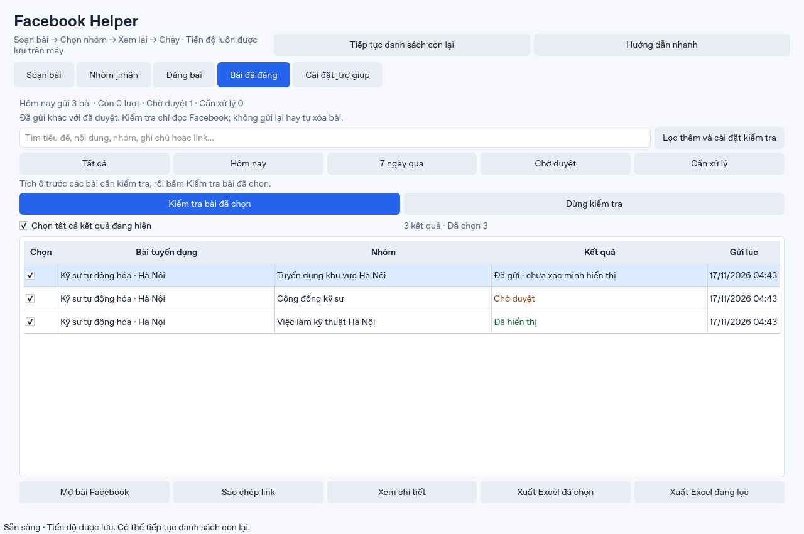

# Facebook Helper · HR

Ứng dụng desktop tiếng Việt cho một người dùng: soạn tin tuyển dụng theo mẫu, chọn nhóm bằng nhãn và thực hiện danh sách đăng lần lượt. **Python + PySide6 + Playwright + SQLite**.

## Tải về và mở ứng dụng

**[Tải bộ cài Windows 10/11 64-bit](https://github.com/Trung27012003/facebook-helper/releases/latest/download/FacebookHelper-Setup-x64.exe)** · **[Bản ZIP portable](https://github.com/Trung27012003/facebook-helper/releases/latest/download/FacebookHelper-Windows-x64.zip)** · [Các bản phát hành](https://github.com/Trung27012003/facebook-helper/releases)

Tải **Setup.exe** → chạy → Cài đặt → mở Facebook Helper từ Start menu. Không cần Python, không cần quyền quản trị. Cập nhật bằng Setup giữ dữ liệu/phiên Facebook. Đóng bản đang chạy trước khi cài. ZIP portable vẫn có: giải nén toàn bộ rồi chạy `FacebookHelper.exe`, giữ `_internal` đi kèm. Bản chưa ký mã số; checksum ở trang phát hành.

## Cách dùng bản 0.10.0 · Summernote

Mỗi lượt đăng thử tối đa 3 lần khi gặp lỗi tạm thời trước gửi. Nếu bản đang mở đã chuẩn bị đủ, lần sau dùng chính bản đó, không dán chữ/tải ảnh lại. Sau bấm Đăng, chỉ cho phép thử lại nếu phản hồi của đúng thao tác xác nhận chưa tạo bài và báo lỗi tạm thời; cần bản soạn vẫn mở, nút Đăng còn dùng được. Đăng nhập/xác thực, hạn chế, kết quả chưa rõ hoặc đã gửi không tự thử lại. Tối đa 3 lần tổng cộng, không phải 3 lần bổ sung.

Ô ngày dùng lịch tiếng Việt của Qt: bấm cả ô để mở, chọn ngày hoặc Hôm nay. Không cần nhập từng phần ngày/tháng/năm.

Cập nhật: sau khi cài bản 0.10.0 trở lên, ứng dụng kiểm tra GitHub Releases công khai khi mở (tối đa một lần/ngày), kiểm tra định kỳ lúc ứng dụng còn mở, có nút kiểm tra thủ công trong Cài đặt. Có bản ổn định mới kèm Setup thì hỏi Tải bộ cài/Để sau. Không tự cài. Thông báo được hoãn khi đang đăng bài. Máy còn dùng bản cũ chưa có bộ kiểm tra cần cài bản này một lần.

Tối ưu: phần tự động hóa Playwright chỉ khởi động khi dùng; gói bỏ Chromium headless dư, source map/type declarations và locale không dùng, giữ tiếng Việt/Anh. Qt WebEngine và Chromium đầy đủ vẫn cần cho Summernote và Facebook. Setup nén LZMA2; ZIP dùng Deflate. Không dọn cookie, ảnh, SQLite hoặc phiên người dùng.

Giao diện dùng nút xanh cho bước chính hiện tại. Khi soạn có thay đổi, **Lưu bài** nổi bật; khi đã lưu, **Chọn nhóm đăng** nổi bật. Thao tác phụ/ảnh nằm trong menu riêng, nút xóa tách khỏi nút lưu. Nút chính vẫn nằm ở cuối khung khi nội dung cuộn.

### 1. Soạn bài

- Chọn **Từ mẫu**. Điền vị trí, công ty, khu vực, thu nhập, công việc, yêu cầu, quyền lợi, địa điểm, thời gian và liên hệ. Mục không cần có thể để trống.
- Mẫu tạo tiêu đề, các phần **CƠ HỘI DÀNH CHO BẠN / YÊU CẦU / QUYỀN LỢI / ỨNG TUYỂN NGAY** và các dòng `•`, giống bố cục bài tuyển dụng tham khảo.
- Dùng **Summernote 0.9.1 nguyên bản** (thanh công cụ của thư viện), đóng kèm jQuery và DOMPurify, chạy offline trong Qt WebEngine. Không còn thanh nút rich text tự ghép.
- **Ctrl+V** từ Word/Facebook giữ các định dạng hỗ trợ. Khi dán từ Facebook, tự bỏ nền tối và màu chữ của giao diện để bài đọc được trên nền trắng; giữ đậm/nghiêng, tiêu đề, danh sách. Bản nháp Qt cũ có nền tối cũng được làm sạch khi mở.
- Thanh thư viện có font, cỡ, màu, đậm/nghiêng/gạch chân, danh sách, bảng, liên kết, mã HTML, fullscreen, undo/redo. **Ctrl+Shift+V** dán chữ thuần. **Thao tác bài → Sao chép có định dạng** sao chép HTML và chữ kèm hashtag.
- Ảnh trong nội dung dán không tự nhập; dùng **Thêm ảnh** để đính kèm. Nguồn chỉ có chữ thuần không thể tự khôi phục kiểu chữ.
- Sửa bài, thêm/sắp xếp ảnh, xem trước và lưu. Facebook chỉ hỗ trợ một phần định dạng; không hỗ trợ toàn bộ font/màu/bố cục Word.

### 2. Nhóm & nhãn

Thêm tên, link nhóm và ghi chú quy định. **Nhãn nhóm** dùng để chọn nơi đăng, không được chèn vào bài.

Ví dụ:

| Nhóm | Nhãn |
|---|---|
| Việc làm kỹ thuật Hà Nội | Hà Nội, Kỹ thuật |
| Cộng đồng tự động hóa | Hà Nội, Kỹ thuật |
| Việc làm kế toán | Hà Nội, Kế toán |

Một nhóm có thể có nhiều nhãn, ngăn cách bằng dấu phẩy. Nhiều nhóm dùng chung nhãn. Chọn nhãn **Kỹ thuật** sẽ chọn hai nhóm đầu; nhãn **Hà Nội** sẽ chọn cả ba. Nhãn khớp chính xác và không phân biệt hoa/thường, không tìm theo một phần tên. Có ô tìm nhóm theo tên/nhãn.

### 3. Đăng bài qua bốn bước

Mở **Trợ giúp** nếu cần: đăng nhập Facebook trong cửa sổ riêng của ứng dụng, thêm nhóm rồi soạn bài.

1. **Chọn bài:** trong Soạn bài bấm **Chọn nhóm đăng** để lưu và đi thẳng sang chọn nhóm. Hoặc vào Đăng bài, chọn một bài đã lưu và xem nội dung.
2. **Chọn nơi đăng:** chọn một nhóm, tích nhiều nhóm hoặc chọn theo nhãn. Có thể bỏ tích những nhóm không cần. Số nhóm và thứ tự hiển thị là thứ tự sẽ thực hiện.
3. **Xem lại:** đọc nội dung, xem ảnh và danh sách nhóm. Chọn tự bấm Đăng hoặc chỉ chuẩn bị; có thể chỉnh thời gian giữa nhóm. Bấm **Bắt đầu đăng** là xác nhận gửi cho danh sách vừa xem. Nếu bài/nhóm thay đổi sau khi xem lại, phải quay lại xem trước khi bắt đầu. Facebook có thể đổi định dạng so với bản xem trước.
4. **Đăng và xem kết quả:** theo dõi nhóm đang làm, thao tác và tiến độ. Có thể **Tạm dừng**; thao tác đang chạy sẽ hoàn tất. Nút Quay lại/Tiếp tục được đặt dưới vùng cuộn. **Tùy chọn khác: xử lý bằng tay** chứa điền bài, đăng bản đang mở, báo đã gửi và bỏ qua nhóm.

**Lưu đợt đăng để chạy sau** chỉ lưu danh sách, không gửi Facebook. Có thể chuẩn bị nhiều đợt cho nhiều bài, rồi mở đợt đã lưu để Bắt đầu / tiếp tục. Mỗi lượt giữ nội dung và ảnh tại thời điểm tạo. Việc tiếp tục đợt đã lưu có xác nhận riêng trước khi gửi.

Sau mỗi bài, hệ thống tự cập nhật kết quả gửi và chuyển nhóm sau thời gian chờ. Không cần xác nhận giữa các nhóm; chờ duyệt không làm dừng danh sách. Lỗi hoặc chưa rõ kết quả sẽ dừng để tránh trùng. **Chỉ chuẩn bị bài** sẽ điền bài nhưng không bấm Đăng; công cụ xử lý bằng tay tự hiện để bạn báo kết quả rồi sang nhóm sau.

Bản 0.7.1 sửa lỗi khôi phục nháp khi mã bài bị dùng lại, tìm kiếm quá 250 ký tự, Hoàn tác khi nạp bài và nhận diện link chỉ trùng tiêu đề. Nháp cũ thiếu định danh được khôi phục thành bài mới để giữ bài đã lưu.

### Bản nháp tự lưu

Nội dung đang soạn được tự lưu riêng sau khi ngừng nhập khoảng 1,2 giây và trước khi đóng ứng dụng. Nháp giữ tên, HTML, hashtag và thứ tự ảnh; **không tự đưa vào danh sách bài có thể đăng**, không cập nhật bài đã lưu hay lượt đã tạo.

Mở lại ứng dụng → Soạn bài → **Khôi phục bản nháp**. Có nhiều nháp thì chọn theo tên và thời gian. Nếu bài gốc đã bị xóa, nháp được mở như bài mới. Không tự bỏ các nháp cũ khi bạn bắt đầu một bài mới; nút Bỏ các bản nháp cũ có xác nhận riêng. Khi bấm Lưu bài thành công, nháp tương ứng được xóa. Khi cố ý bỏ chỉnh sửa để chuyển bài, nháp của phần chỉnh sửa đó cũng được bỏ.

Nếu không tự lưu được khi đóng, ứng dụng giữ cửa sổ mở và báo để bạn lưu hoặc kiểm tra ổ đĩa. Thay đổi trong khoảng ngay trước sự cố mất điện có thể chưa kịp được lưu. Nháp nằm trong SQLite và được đưa vào bản sao lưu dữ liệu; ảnh dùng các tệp đã nhập vào ứng dụng.

### Quản lý bài đăng

Mặc định chỉ hiển thị **hôm nay**. Chọn **Đợt đăng**, **Từ ngày**, **Đến ngày**, nhập từ khóa nếu cần rồi bấm **Tìm kiếm** (hoặc Enter). Không có nút lọc nhanh, lịch sử, ô tích hay kiểm tra duyệt. Kết quả chỉ đổi theo bộ lọc đã bấm Tìm kiếm; việc cập nhật từ trình duyệt không áp dụng các ô bạn đang sửa dở.

Bảng gồm đợt đăng, bài viết, nhóm, thời gian, kết quả gửi và link. Chọn một dòng rồi **Mở bài**, **Sao chép link** hoặc **Mở nhóm**; thiếu link thì chỉ Mở bài/Sao chép link tắt, Mở nhóm vẫn dùng được. **Xuất Excel** lấy tất cả kết quả đang tìm được. “Đã gửi” áp dụng cả bài đang chờ duyệt, không khẳng định được quản trị viên duyệt.

Khoảng ngày tính theo giờ trên máy và gồm cả hai đầu. Cột **Thời gian** ưu tiên ngày gửi, rồi ngày thử gửi, cuối cùng là ngày tạo với lượt chưa gửi hoặc dữ liệu cũ thiếu ngày gửi. Không ghi ngày thay thế vào `sent_at`.

Sau khi gửi, ứng dụng lấy permalink từ phản hồi gửi bài nếu nhận diện đúng thao tác/nội dung/nhóm, hoặc từ bài mới đúng nội dung trên trang. Việc lấy link chạy cả với bài chờ duyệt, không gọi kiểm tra duyệt. Facebook chưa cung cấp link thì lưu kết quả gửi và để trống link, vẫn tiếp tục nhóm sau. Không suy đoán link từ ID không rõ loại. Hỗ trợ link số và dạng `pfbid…`.

**Xóa** → chọn xóa dòng đang chọn hoặc các bài đã gửi trong kết quả đang lọc. Có xác nhận số lượng; không xóa bài Facebook, bài soạn hoặc nhóm. Lượt chưa gửi/đang chạy được giữ. Biên nhận nội bộ của lượt gửi được giữ để bảo vệ tiến độ và cảnh báo đăng trùng; chỉ gỡ bản ghi khỏi trang Bài đã đăng.

Phản hồi chỉ có `post_id`/`legacy_story_hideable_id` hợp lệ cũng được dùng để lưu link, kể cả chờ duyệt. Chỉ nhận các trường mã bài từ phản hồi của đúng thao tác gửi; không dùng ID người dùng hay ID GraphQL không rõ loại. Chờ thêm tối đa 3 giây nếu phản hồi gửi vẫn đang tải. Link bài chờ duyệt có thể chưa mở được trước khi quản trị viên duyệt. Không có URL hoặc mã bài hợp lệ thì vẫn ghi “Chưa có link”; không thể bảo đảm lấy link cho mọi bài Facebook.

Trang **Đăng bài** hiển thị nút theo trạng thái: Bắt đầu/Tiếp tục khi còn nhóm, Tạm dừng khi đang chạy, Bài đã đăng được làm nổi bật khi hoàn tất. Đã bỏ chỉ dẫn dài, thanh các bước và nút Bắt đầu khỏi trạng thái hoàn tất. Link hiển thị trực tiếp trong bảng; Mở bài, Sao chép link, Mở nhóm nằm cùng hàng. Mở nhóm/bài dùng trình duyệt mặc định của máy, không điều hướng cửa sổ Playwright đang đăng.

Bộ lấy link không còn yêu cầu nội dung gửi đi giống hệt bản lưu; chỉ nhận phản hồi từ request tạo bài bắt đầu trong thao tác Đăng này, đúng nhóm. Hỗ trợ request bắt đầu muộn và phản hồi GraphQL bổ sung theo đường dẫn story_create đã nhận diện. Không gọi API riêng, không gửi lại bài để lấy link.

Nếu vẫn thiếu link, `link-diagnostics.json` trong thư mục dữ liệu lưu tối đa 30 lần gửi: phiên bản, thời gian, mã lượt cục bộ, số request/phản hồi, cờ có loại trường mã bài và kết quả lấy link. Không lưu nội dung, link, mã Facebook, cookie, token hoặc phản hồi thô trong file này. Dùng **Cài đặt → Xuất chẩn đoán** để lưu file gửi hỗ trợ; nút bật sau khi có dữ liệu chẩn đoán.

Kiểm tra duyệt định kỳ đã tắt, kể cả khi bản cũ từng bật. Dữ liệu cũ được giữ; không còn phần lịch sử trên giao diện quản lý.

### Chống trùng và tiếp tục sau gián đoạn

Tạo danh sách/lượt mới sẽ cảnh báo nếu cùng nội dung (chuẩn hóa khoảng trắng) và cùng ảnh (so sánh bytes) đã có lượt trong cùng nhóm, kể cả lưu dưới tên bài khác. Có thể xác nhận tạo lượt để đăng lại có chủ đích. Trước khi tự gửi, ứng dụng kiểm tra lại các lượt đã gửi/chưa rõ kết quả ở danh sách khác; không gửi lại cùng lượt đã hoàn tất. Nhóm dùng ID và tên khác nhau chưa được tự ánh xạ với nhau.

Tiến độ, nội dung và thứ tự được lưu sau từng nhóm. Khi mở lại, lượt đang gửi được chuyển **Chưa rõ kết quả**; không tự gửi lại. Dùng **Tiếp tục đợt đăng**, kiểm tra các lượt chưa rõ rồi Bắt đầu / tiếp tục. Các lượt đã gửi/chờ duyệt/hiển thị được bỏ qua. Ứng dụng không tự bấm Đăng ngay lúc khởi động.


Link được lưu tự động khi nhận diện được link bài mới đúng nhóm; không lấy link bài cũ có sẵn trước lúc gửi. Nếu không nhận diện được, trạng thái giữ là đã gửi và link để trống, không tự bịa link hoặc đánh dấu đã hiển thị. Việc quản trị viên duyệt bài vẫn do nhóm quyết định.


**Không có bảo đảm tránh phát hiện, tránh kiểm duyệt hoặc tránh xóa bài.** Bài bị xóa có thể do nội dung, quy định nhóm, quản trị viên, trạng thái tài khoản hoặc nền tảng. Chưa xác minh nguyên nhân nếu không có thông báo thực tế. Các kiểm tra cảnh báo trong ứng dụng là hỗ trợ, không phát hiện được mọi trường hợp bài bị gỡ âm thầm.

### Link, ảnh minh chứng và báo cáo

Mở **Chi tiết** bên dưới bảng. Dán và lưu link bài, hoặc mở bài cụ thể trong trình duyệt của ứng dụng rồi **Lấy link đang mở**. Link cần thuộc cùng nhóm, dạng `/groups/ID/posts/ID/`; nếu Facebook dùng ID/tên nhóm khác nhau, hãy dùng cùng cách định danh với nhóm đã lưu.

**Mở link bài** → kiểm tra bài và vị trí cuộn → **Chụp màn hình** → **Xem ảnh minh chứng**. Ảnh chỉ là vùng đang hiển thị, không tự chứng minh bài đã được duyệt. Đổi sang permalink khác sẽ bỏ liên kết minh chứng cũ và yêu cầu xác nhận lại; file ảnh cũ vẫn được giữ.

**Xuất Excel** xuất lịch sử các lượt. Đường dẫn ảnh trong Excel là tương đối; gửi kèm ảnh/bản sao lưu khi cần chia sẻ minh chứng.

## Giao diện bản mới




## Cập nhật, dữ liệu và sao lưu

Bản 0.4 giữ dữ liệu cũ và bổ sung HTML vào các lượt đăng mới, giữ bài, ảnh, nhóm và lịch sử cũ. Giải nén bản mới vào thư mục khác rồi chạy; dữ liệu nằm ngoài thư mục ứng dụng. Nên sao lưu ZIP trước khi cập nhật.

Tab **Dữ liệu & hướng dẫn** cho biết đường dẫn chính xác và có nút mở thư mục/sao lưu:

- Windows: thường `%LOCALAPPDATA%\FacebookHelper`.
- macOS: `~/Library/Application Support/FacebookHelper`.
- Linux: `~/.local/share/FacebookHelper`.

`helper.db` chứa bài/nhóm/nhãn/danh sách/lịch sử; `images/` chứa ảnh; `evidence/` chứa minh chứng; `browser/` chứa phiên Facebook. **Không chia sẻ hoặc commit `browser/`.** ZIP sao lưu cố ý không chứa phiên đăng nhập. Muốn xóa phiên, đóng ứng dụng rồi xóa thư mục `browser/` trong dữ liệu.

Khôi phục: đóng ứng dụng, sao lưu dữ liệu hiện tại, giải nén ZIP do chính ứng dụng tạo vào thư mục dữ liệu rồi mở lại. Máy mới cần đăng nhập Facebook lại. Ảnh không còn dùng vẫn được giữ để bảo toàn lịch sử. Ảnh xuất tạm để tải thủ công nằm trong thư mục tạm hệ điều hành với tiền tố `facebook-helper-images-`.

## Giới hạn thực tế

Chưa có AI, hẹn giờ, thiết kế poster, tự tìm permalink bài mới hay tự phát hiện phê duyệt. Tự động thao tác phụ thuộc giao diện/ngôn ngữ/quyền của nhóm Facebook và cần kiểm thử trên tài khoản thật. Không vượt CAPTCHA, hạn chế tài khoản hoặc bảo đảm tránh khóa tài khoản. Ứng dụng độc lập, không phải sản phẩm chính thức của Meta.

## Chạy từ mã nguồn

Windows (Python 3.11+ và Git):

```powershell
git clone https://github.com/Trung27012003/facebook-helper.git
cd facebook-helper
py -m venv .venv
.\.venv\Scripts\python.exe -m pip install -e .
.\.venv\Scripts\python.exe -m playwright install chromium
.\.venv\Scripts\python.exe -m facebook_helper
```

Lần sau dùng `start.bat`. Trên macOS/Linux dùng `python3 -m venv .venv` rồi các lệnh tương tự với `.venv/bin/python`. Linux cần thư viện Qt/Chromium và desktop. Có thể dùng `--data-dir /duong/dan/rieng` để tách dữ liệu thử nghiệm.

## Bản 0.4.2: bỏ chặn đối chiếu nội dung

Đã bỏ hoàn toàn việc so sánh bản lưu với văn bản đọc từ Facebook, kể cả độ dài, từng chữ, số và kiểu định dạng trong DOM. Các test cũ yêu cầu chặn sai số tiền/thiếu đoạn do đối chiếu không còn là hành vi của bản này. Ứng dụng chỉ chờ chữ được nhận, ảnh tải xong và nút Đăng bấm được; nội dung/định dạng cuối cùng cần được người dùng kiểm tra trong Facebook.

Vẫn dừng khi ô trống, thiếu tệp ảnh, sai nhóm, Facebook báo lỗi/hạn chế/xác thực hoặc chưa rõ kết quả sau bấm. Không tự dán lại hoặc bấm Đăng lần hai khi kết quả chưa rõ. Tự đăng được bật mặc định; nhóm tiếp theo được thực hiện tự động khi bài trước gửi xong.

## Kiểm thử và đóng gói

[Thư viện và giấy phép](docs/THIRD-PARTY.md). Thư viện được đóng kèm, không cần CDN khi chạy.

[Kết quả chạy ngày 17/11/2026](docs/TEST-RUN-2026-11-17.md) · [Excel kết quả từng ca](docs/TEST-RESULTS-2026-11-17.xlsx).

[Checklist kiểm thử toàn bộ](docs/TEST-CHECKLIST.md) và [bản Excel để đánh dấu](docs/TEST-CHECKLIST.xlsx) gồm đầu mục, ưu tiên, kết quả mong đợi và mẫu ghi lỗi.

[Kết quả chạy ngày 17/11/2026](docs/TEST-RUN-2026-11-17.md) · [Excel kết quả từng ca](docs/TEST-RESULTS-2026-11-17.xlsx).

[Checklist kiểm thử toàn bộ](docs/TEST-CHECKLIST.md) và [bản Excel để đánh dấu](docs/TEST-CHECKLIST.xlsx) gồm đầu mục, ưu tiên, kết quả mong đợi và mẫu ghi lỗi.

Xem [kiểm thử bản 0.10.0](docs/TESTING-v0.10.0.md), [kiểm thử bản 0.9.0](docs/TESTING-v0.9.0.md), [kiểm thử bản 0.8.1](docs/TESTING-v0.8.1.md), [kiểm thử bản 0.8.0](docs/TESTING-v0.8.0.md), [kiểm thử bản 0.7.1](docs/TESTING-v0.7.1.md), [kiểm thử bản 0.7.0](docs/TESTING-v0.7.0.md), [kiểm thử bản 0.6.0](docs/TESTING-v0.6.0.md), [kiểm thử bản 0.5.0](docs/TESTING-v0.5.0.md), [kiểm thử bản 0.4.2](docs/TESTING-v0.4.2.md), [kiểm thử bản 0.4.1](docs/TESTING-v0.4.1.md), [kiểm thử bản 0.4](docs/TESTING-v0.4.md), [kiểm thử bản 0.3](docs/TESTING-v0.3.md), [kiểm thử bản 0.2](docs/TESTING-v0.2.md) và [kiểm thử bản 0.1](docs/TESTING.md). Test trình duyệt chạy Chromium với HTML mô phỏng, không đăng Facebook thật.

```bash
python -m pip install -e '.[dev]'
python -m playwright install chromium
ruff check .
ruff format --check .
QT_QPA_PLATFORM=offscreen QTWEBENGINE_DISABLE_SANDBOX=1 QTWEBENGINE_CHROMIUM_FLAGS=--disable-gpu pytest -q
```

Các biến Qt offscreen/sandbox trong lệnh trên chỉ dùng cho môi trường kiểm thử Linux dạng container; không thiết lập chúng để né kiểm tra của Facebook. Bản Windows dùng Qt native và sandbox mặc định.

Workflow **Build Windows** tạo gói portable, chạy file `.exe` với Qt và Chromium trên Windows, rồi chỉ phát hành khi kiểm tra thành công. Chạy thủ công ở Actions; trường `release_tag` cho phép phát hành phiên bản mới. Hướng dẫn từng gói nằm trong `HUONG-DAN.txt` đi kèm.
