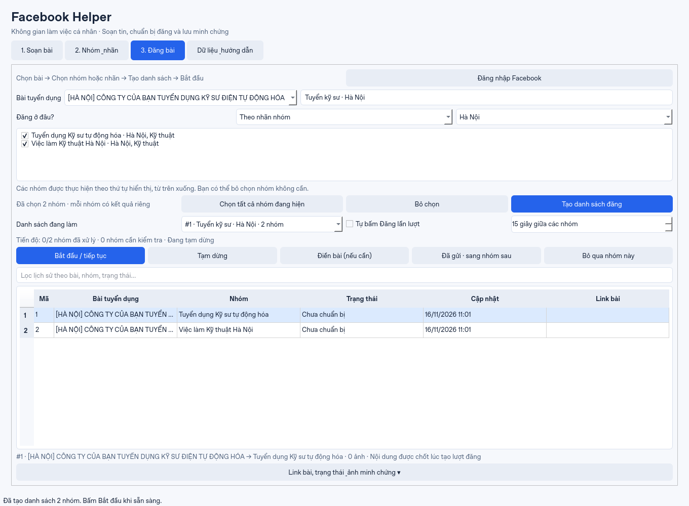

# Facebook Helper · HR

Ứng dụng desktop tiếng Việt cho một người dùng: soạn tin tuyển dụng theo mẫu, chọn nhóm bằng nhãn và thực hiện danh sách đăng lần lượt. **Python + PySide6 + Playwright + SQLite**.

## Tải về và mở ứng dụng

**[Tải bản Windows 10/11 64-bit](https://github.com/Trung27012003/facebook-helper/releases/latest/download/FacebookHelper-Windows-x64.zip)** · [Các bản phát hành](https://github.com/Trung27012003/facebook-helper/releases)

Giải nén **toàn bộ** ZIP → mở thư mục `FacebookHelper` → nhấp đúp `FacebookHelper.exe`. Không cần cài Python hay Chromium. Giữ nguyên `_internal` đi kèm, không chạy bên trong ZIP. Bản portable chưa ký mã số; thông tin kiểm tra và SHA256 nằm ở trang phát hành.

## Cách dùng bản 0.4 · Summernote

### 1. Soạn bài

- Chọn **Tạo bài theo mẫu tuyển dụng**. Điền vị trí, công ty, khu vực, thu nhập, công việc, yêu cầu, quyền lợi, địa điểm, thời gian và liên hệ. Mục không cần có thể để trống.
- Mẫu tạo tiêu đề, các phần **CƠ HỘI DÀNH CHO BẠN / YÊU CẦU / QUYỀN LỢI / ỨNG TUYỂN NGAY** và các dòng `•`, giống bố cục bài tuyển dụng tham khảo.
- Dùng **Summernote 0.9.1 nguyên bản** (thanh công cụ của thư viện), đóng kèm jQuery và DOMPurify, chạy offline trong Qt WebEngine. Không còn thanh nút rich text tự ghép.
- **Ctrl+V** từ Word/Facebook giữ các định dạng hỗ trợ. Khi dán từ Facebook, tự bỏ nền tối và màu chữ của giao diện để bài đọc được trên nền trắng; giữ đậm/nghiêng, tiêu đề, danh sách. Bản nháp Qt cũ có nền tối cũng được làm sạch khi mở.
- Thanh thư viện có font, cỡ, màu, đậm/nghiêng/gạch chân, danh sách, bảng, liên kết, mã HTML, fullscreen, undo/redo. **Ctrl+Shift+V** dán chữ thuần. **Sao chép bài có định dạng** sao chép HTML và chữ kèm hashtag.
- Ảnh trong nội dung dán không tự nhập; dùng **Thêm ảnh** để đính kèm. Nguồn chỉ có chữ thuần không thể tự khôi phục kiểu chữ.
- Sửa bài, thêm/sắp xếp ảnh, xem trước và lưu. Facebook chỉ hỗ trợ một phần định dạng; không hỗ trợ toàn bộ font/màu/bố cục Word.

### 2. Nhóm & nhãn

Thêm tên, link nhóm và ghi chú quy định. **Nhãn nhóm** dùng để chọn nơi đăng, không được chèn vào bài.

Ví dụ:

| Nhóm | Nhãn |
|---|---|
| Việc làm kỹ thuật Hà Nội | Hà Nội, Kỹ thuật |
| Cộng đồng tự động hóa | Hà Nội, Kỹ thuật |
| Việc làm kế toán | Hà Nội, Kế toán |

Một nhóm có thể có nhiều nhãn, ngăn cách bằng dấu phẩy. Nhiều nhóm dùng chung nhãn. Chọn nhãn **Kỹ thuật** sẽ chọn hai nhóm đầu; nhãn **Hà Nội** sẽ chọn cả ba. Nhãn khớp chính xác và không phân biệt hoa/thường, không tìm theo một phần tên. Có ô tìm nhóm theo tên/nhãn.

### 3. Đăng bài lần lượt

1. Bấm **Đăng nhập Facebook** ở đầu màn hình, đăng nhập trực tiếp trong trình duyệt riêng của ứng dụng. Phiên không dùng chung với Chrome cá nhân.
2. Chọn một bài đã lưu, rồi chọn **Một nhóm**, **Nhiều nhóm** hoặc **Theo nhãn nhóm**.
3. Kiểm tra danh sách đã tích; có thể bỏ bớt nhóm. Thứ tự thực hiện là từ trên xuống.
4. Đặt tên danh sách nếu muốn → **Tạo danh sách đăng**. Mỗi nhóm có một lượt riêng, giữ bản nội dung/ảnh tại thời điểm tạo. Có thể tạo nhiều danh sách cho nhiều bài khác nhau trước khi bắt đầu.
5. **Bắt đầu / tiếp tục** mở nhóm và dán bài qua clipboard HTML, giữ phần ngữ nghĩa như đậm/nghiêng/danh sách. Nếu ô Facebook không giữ định dạng, ứng dụng dừng trước khi bấm Đăng; không âm thầm đổi sang bản chữ thường. Bạn có thể tự dán bằng Ctrl+V và kiểm tra định dạng trực tiếp trên Facebook.
6. Mặc định bạn tự bấm Đăng. Tùy chọn **Ứng dụng bấm Đăng · kiểm tra từng nhóm** chỉ gửi nhóm đang làm sau xác nhận. **Sau mỗi bài luôn dừng**, không tự chuyển nhóm chỉ vì cửa sổ soạn đã đóng.
7. Kiểm tra bài còn hiển thị hay đang chờ duyệt. Bấm **Đã gửi · sang nhóm sau** và chọn kết quả đã kiểm tra. Chọn “cần kiểm tra lại” sẽ tiếp tục dừng. Nếu bài bị gỡ, ghi trạng thái/ghi chú phù hợp, kiểm tra thông báo và quy định nhóm trước khi quyết định bước tiếp.
8. **Tạm dừng / Bỏ qua** vẫn dùng được. Khi Facebook báo hạn chế, xác thực hoặc xóa bài, ứng dụng dừng và lưu thông báo; không tự gửi lại. Tắt giữa lúc gửi cũng cần kiểm tra trước khi tiếp tục.

**Không có bảo đảm tránh phát hiện, tránh kiểm duyệt hoặc tránh xóa bài.** Bài bị xóa có thể do nội dung, quy định nhóm, quản trị viên, trạng thái tài khoản hoặc nền tảng. Chưa xác minh nguyên nhân nếu không có thông báo thực tế. Các kiểm tra cảnh báo trong ứng dụng là hỗ trợ, không phát hiện được mọi trường hợp bài bị gỡ âm thầm.

### Link, ảnh minh chứng và báo cáo

Mở **Link bài, trạng thái & ảnh minh chứng** bên dưới bảng. Dán và lưu link bài, hoặc mở bài cụ thể trong trình duyệt của ứng dụng rồi **Lấy link đang mở**. Link cần thuộc cùng nhóm, dạng `/groups/ID/posts/ID/`; nếu Facebook dùng ID/tên nhóm khác nhau, hãy dùng cùng cách định danh với nhóm đã lưu.

**Mở link bài** → kiểm tra bài và vị trí cuộn → **Chụp màn hình** → **Xem ảnh minh chứng**. Ảnh chỉ là vùng đang hiển thị, không tự chứng minh bài đã được duyệt. Đổi sang permalink khác sẽ bỏ liên kết minh chứng cũ và yêu cầu xác nhận lại; file ảnh cũ vẫn được giữ.

**Xuất Excel** xuất lịch sử các lượt. Đường dẫn ảnh trong Excel là tương đối; gửi kèm ảnh/bản sao lưu khi cần chia sẻ minh chứng.

## Giao diện bản mới




## Cập nhật, dữ liệu và sao lưu

Bản 0.4 giữ dữ liệu cũ và bổ sung HTML vào các lượt đăng mới, giữ bài, ảnh, nhóm và lịch sử cũ. Giải nén bản mới vào thư mục khác rồi chạy; dữ liệu nằm ngoài thư mục ứng dụng. Nên sao lưu ZIP trước khi cập nhật.

Tab **Dữ liệu & hướng dẫn** cho biết đường dẫn chính xác và có nút mở thư mục/sao lưu:

- Windows: thường `%LOCALAPPDATA%\FacebookHelper`.
- macOS: `~/Library/Application Support/FacebookHelper`.
- Linux: `~/.local/share/FacebookHelper`.

`helper.db` chứa bài/nhóm/nhãn/danh sách/lịch sử; `images/` chứa ảnh; `evidence/` chứa minh chứng; `browser/` chứa phiên Facebook. **Không chia sẻ hoặc commit `browser/`.** ZIP sao lưu cố ý không chứa phiên đăng nhập. Muốn xóa phiên, đóng ứng dụng rồi xóa thư mục `browser/` trong dữ liệu.

Khôi phục: đóng ứng dụng, sao lưu dữ liệu hiện tại, giải nén ZIP do chính ứng dụng tạo vào thư mục dữ liệu rồi mở lại. Máy mới cần đăng nhập Facebook lại. Ảnh không còn dùng vẫn được giữ để bảo toàn lịch sử. Ảnh xuất tạm để tải thủ công nằm trong thư mục tạm hệ điều hành với tiền tố `facebook-helper-images-`.

## Giới hạn thực tế

Chưa có AI, hẹn giờ, thiết kế poster, tự tìm permalink bài mới hay tự phát hiện phê duyệt. Tự động thao tác phụ thuộc giao diện/ngôn ngữ/quyền của nhóm Facebook và cần kiểm thử trên tài khoản thật. Không vượt CAPTCHA, hạn chế tài khoản hoặc bảo đảm tránh khóa tài khoản. Ứng dụng độc lập, không phải sản phẩm chính thức của Meta.

## Chạy từ mã nguồn

Windows (Python 3.11+ và Git):

```powershell
git clone https://github.com/Trung27012003/facebook-helper.git
cd facebook-helper
py -m venv .venv
.\.venv\Scripts\python.exe -m pip install -e .
.\.venv\Scripts\python.exe -m playwright install chromium
.\.venv\Scripts\python.exe -m facebook_helper
```

Lần sau dùng `start.bat`. Trên macOS/Linux dùng `python3 -m venv .venv` rồi các lệnh tương tự với `.venv/bin/python`. Linux cần thư viện Qt/Chromium và desktop. Có thể dùng `--data-dir /duong/dan/rieng` để tách dữ liệu thử nghiệm.

## Kiểm thử và đóng gói

[Thư viện và giấy phép](docs/THIRD-PARTY.md). Thư viện được đóng kèm, không cần CDN khi chạy.

Xem [kiểm thử bản 0.4](docs/TESTING-v0.4.md), [kiểm thử bản 0.3](docs/TESTING-v0.3.md), [kiểm thử bản 0.2](docs/TESTING-v0.2.md) và [kiểm thử bản 0.1](docs/TESTING.md). Test trình duyệt chạy Chromium với HTML mô phỏng, không đăng Facebook thật.

```bash
python -m pip install -e '.[dev]'
python -m playwright install chromium
ruff check .
ruff format --check .
QT_QPA_PLATFORM=offscreen QTWEBENGINE_DISABLE_SANDBOX=1 QTWEBENGINE_CHROMIUM_FLAGS=--disable-gpu pytest -q
```

Các biến Qt offscreen/sandbox trong lệnh trên chỉ dùng cho môi trường kiểm thử Linux dạng container; không thiết lập chúng để né kiểm tra của Facebook. Bản Windows dùng Qt native và sandbox mặc định.

Workflow **Build Windows** tạo gói portable, chạy file `.exe` với Qt và Chromium trên Windows, rồi chỉ phát hành khi kiểm tra thành công. Chạy thủ công ở Actions; trường `release_tag` cho phép phát hành phiên bản mới. Hướng dẫn từng gói nằm trong `HUONG-DAN.txt` đi kèm.
